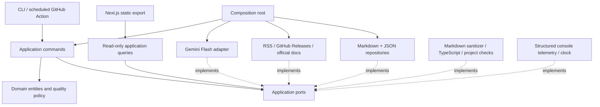
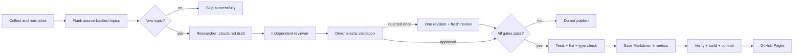

# DevSignal AI

**Engineering intelligence, distilled.** An autonomous technical publication that earns the right to publish: collect trusted updates, rank topics, write an evidence-grounded article, challenge it with an independent AI reviewer, apply deterministic gates, and deploy a static website.

Built with Node.js, strict TypeScript, Next.js App Router, Gemini Flash, Zod, Vitest, and GitHub Actions. Markdown is the article store; JSON holds bounded pipeline metrics. No database, runtime server, paid search, or embeddings.

The repository starts with an honest empty publication. Deterministic fixtures demonstrate the complete workflow without inventing published articles, sources, or review results. The website is responsive, keyboard accessible, and includes topic filtering, article pages, review metadata, a pipeline status page, SEO metadata, and a sitemap.

## Architecture



The domain contains schemas, URL normalization, deterministic ranking, Jaccard token similarity, and review policy. Application commands depend on ports, never Gemini, Next.js, GitHub, or filesystem implementations. Query constructors receive read-only repository interfaces. ESLint checks import boundaries. No command bus is needed for a small, serial workflow.

```text
src/
  domain/          entities, value objects, quality policy, errors
  application/     commands, queries, DTOs, ports
  infrastructure/  AI, sources, repositories, publishing, telemetry
  interfaces/      CLI and web composition
  app/             Next.js-required App Router entry points
  config/          Zod environment configuration and trusted sources
  container/       Dependency wiring
content/articles/  Validated Markdown and frontmatter
data/             Bounded JSON metrics
tests/            Unit/integration tests and deterministic fixtures
docs/adr/         Architectural Decision Records
```

## Publication pipeline



Each article contains a title, publication date, executive summary, what changed, why it matters, technical explanation, a self-contained TypeScript program, implementation considerations, trade-offs, when to use and avoid it, limitations, two or more sources, review scores, and validation metadata. The primary update is distinguished from reference documentation, whose collection date is not a release date.

## Local setup

Use **Node.js 22.18+ or Node.js 24** and npm. TypeScript is pinned to the 5.9 compiler API used for in-memory snippet checks; ESLint is pinned to the supported React plugin major. Dependencies use exact versions and a committed npm lockfile.

```sh
npm ci
cp .env.example .env
npm run dev
```

Open `http://localhost:3000`. No API key is needed to browse or build the website. Environment files and caches are ignored by Git. No externally hosted fonts or images are needed.

### Gemini Free Tier

Create an API key in [Google AI Studio](https://aistudio.google.com/apikey) for a project **without a billing account**. Put it in `.env`:

```dotenv
GEMINI_API_KEY=your-key-here
GEMINI_MODEL=gemini-3.6-flash
FREE_TIER_ONLY=true
```

Do not use a `NEXT_PUBLIC_` prefix for the key. It is read only by the CLI composition, never by the web data module. The default is `gemini-3.6-flash`. The allowlist also retains `gemini-2.5-flash` and `gemini-2.5-flash-lite` for projects that still have access. Google rejects Gemini 2.5 Flash generation for new users even when its model-list endpoint includes it. Gemini 3.6 uses minimal thinking; legacy 2.5 models use a zero thinking budget. There is no paid fallback, search grounding, or caching tool.

Google controls eligibility, model availability, and quotas. Check your AI Studio project before enabling the schedule. `FREE_TIER_ONLY` expresses the intended mode; it cannot inspect your billing configuration. Keep billing disabled to make the monetary bound zero. The application cannot promise a provider will retain its current Free Tier indefinitely.

### Run the daily pipeline

```sh
npm run pipeline
npm run pipeline:dry
```

A live dry run fetches public sources and uses Gemini, consumes quota, executes all gates, and writes no article, checkpoint, lock, or pipeline state. Compiler emission and test-result caches are disabled; integration tests use disposable temporary directories outside the project. For a fully offline demonstration without credentials:

```sh
npm run pipeline -- --dry-run --fixture
```

The fixture mode is accepted only for a dry run. Test drafts are labelled explicitly and cannot be published via that mode. It still runs the actual TypeScript, lint, and test gates. Generated programs are **type-checked, never executed**; the word executable describes a self-contained example readers can run, not a claim that its behavior has been tested automatically.

### Run individual stages

```sh
npm run stage -- collect
npm run stage -- rank
npm run stage -- generate
npm run stage -- review
npm run stage -- validate
npm run stage -- publish
```

Stages share `.cache/checkpoint.json`. Run collection first; checkpoints expire after 24 hours. `rank` displays candidates. `generate`, `review`, and `validate` preserve their results for inspection. `publish` reruns validation and project checks instead of trusting a checkpoint flag. The checkpoint tracks model calls across processes, enforcing the same configured budget. Repeated stage commands do not create an unlimited revision loop. The `run` command is the fully automatic orchestration, including one corrective revision.

Every stage accepts `--dry-run`, which reads prerequisites and reports results without saving them. A dry collection therefore does not create a checkpoint for later commands. Run the full dry pipeline to test the entire chain in memory. A local lock serializes mutating CLI executions; do not edit content concurrently with a pipeline run.

## Configuration and cost controls

Configuration is validated by Zod before the pipeline starts. Unknown environment variables are ignored; invalid settings produce a field-name error without exposing values.

| Variable                | Default                 | Bound / purpose                              |
| ----------------------- | ----------------------- | -------------------------------------------- |
| `GEMINI_MODEL`          | `gemini-3.6-flash`      | Explicit Flash Free Tier allowlist           |
| `MAX_LLM_CALLS`         | `4`                     | 1–4 requests per run, including failures     |
| `MAX_OUTPUT_TOKENS`     | `6000`                  | 1,000–8,000 per request                      |
| `MAX_INPUT_CHARS`       | `60000`                 | 5,000–100,000; fails closed if exceeded      |
| `MAX_ARTICLES_PER_DAY`  | `1`                     | 1–3, enforced from persisted articles in UTC |
| `SOURCE_LOOKBACK_DAYS`  | `14`                    | 1–30; only applies to updates                |
| `MIN_REVIEW_SCORE`      | `85`                    | Cannot be set below 85                       |
| `MIN_CATEGORY_SCORE`    | `80`                    | Cannot be set below 80                       |
| `DUPLICATE_THRESHOLD`   | `0.65`                  | 0.3–0.8 Jaccard similarity                   |
| `FREE_TIER_ONLY`        | `true`                  | False is rejected                            |
| `NEXT_PUBLIC_SITE_URL`  | `http://localhost:3000` | Site origin, without a trailing slash        |
| `NEXT_PUBLIC_BASE_PATH` | empty                   | `/repository` for project Pages sites        |

The SDK performs one HTTP attempt per counted call, with a 60-second timeout and no retries. A 429 ends successfully with `quota_exhausted`, without an article. A smaller call budget can stop before a revision; the platform prioritizes the limit over publication. Token telemetry uses provider totals where available and conservative estimates otherwise.

## GitHub setup

1. Create a **public** GitHub repository, push this project to its default branch, and enable Actions. Public hosted runners and Pages are the intended free environment; private repository plans may have different allowances.
2. In **Settings → Secrets and variables → Actions**, create the repository secret **`GEMINI_API_KEY`**. Do not commit `.env` or credentials.
3. In **Settings → Pages**, choose **GitHub Actions** as the build source. Permit the `github-pages` environment to deploy from the default branch. The included workflows request only their required permissions.
4. The daily job uses the built-in `GITHUB_TOKEN` with `contents: write` in its publishing job. Ensure repository policy allows it to push. No personal access token is required. If protected-branch rules prohibit direct bot pushes, use an allowed automation identity or adapt publication to a reviewed PR; this project never force-pushes or bypasses protection.
5. The author defaults to GitHub's bot identity: `github-actions[bot]` / `41898282+github-actions[bot]@users.noreply.github.com`. Optional repository variables `PUBLISH_AUTHOR_NAME` and `PUBLISH_AUTHOR_EMAIL` replace it. Supply an email verified on the intended account (or its GitHub noreply address). Syntax is checked; the workflow cannot verify ownership of arbitrary email addresses.
6. Trigger **Daily publishing → Run workflow** for the first live execution, or wait for the daily **06:17 UTC** schedule. Scheduled Actions run on the default branch and may be delayed or disabled after inactivity.

The deployment workflow derives `https://owner.github.io` and the repository base path automatically. For a custom domain, set repository variable `SITE_URL` to its HTTPS origin and, if needed, `SITE_BASE_PATH` to a single `/segment`. Configure DNS and the Pages custom domain separately. The default requires no domain purchase.

### Workflow behavior

- **CI** runs installation via `npm ci`, strict type-checking, lint, tests, formatting, stored-content verification, and static export for pushes and PRs. It receives no Gemini secret.
- **Daily publishing** locks scheduled runs, limits execution time, and runs the pipeline. Only the pipeline step receives the Gemini key. After a new validated article is produced, the job re-verifies content, runs all checks and the build, stages only article files and metrics, commits, and pushes to the default branch. A no-topic, rejection, or quota result creates no commit.
- **Deploy Pages** runs after successful default-branch push CI and is also reusable by the daily workflow. Pushes made with `GITHUB_TOKEN` do not recursively trigger ordinary workflows; the daily job therefore calls deployment explicitly with the exact new commit. PRs and fork runs cannot deploy. Superseded revisions are skipped, and Pages deployments are serialized.

Actions are pinned to commit SHAs. Dependabot proposes dependency and action updates. Review changes to the model allowlist manually; a new model name is not evidence that it is free.

## Quality gates

Publication fails closed if any of the following fails:

- Strict Zod draft, review, article, source, and metrics schemas.
- A new safe slug, unique primary update, and deterministic topic similarity checks against the archive.
- HTTPS-only, credential-free, allowed-host URLs and at least two distinct citations actually present in the ingestion snapshot.
- Specific, adequately sized sections without repeated generic text, hidden links, raw HTML, or placeholder language.
- An independent review with overall **≥85**, actual category mean **≥85**, every category **≥80**, an approval flag, and empty unsupported-claim and invented-source lists.
- Canonical Markdown sanitization and strict TypeScript compilation of the extracted example. Imports, external packages, `eval`, process access, explicit `any`, type assertions, compiler suppression, and reference directives are rejected in examples.
- Application type-check, tests, and lint before the publisher saves a file; content verification and static build before a workflow commit/deploy.

Quality tests are not proof of correctness. Source matching proves provenance, not the truth of every claim. Related documentation must substantively support the explanation; the reviewer is instructed to reject superficial corroboration. Semantically similar articles with different wording can evade token similarity. Reviewer and researcher requests are separate, but a shared model can share errors.

## Tests and verification

```sh
npm run typecheck
npm run lint
npm test
npm run format:check
npm run verify:content
npm run build
npm run test:static # Isolated populated export, including Pages base paths
# Or all core checks:
npm run check
```

Tests use deterministic fake adapters and never contact Gemini. Coverage includes normalization, topic ranking, similarity, structured outputs, orchestration and revision, threshold enforcement, citation provenance, source transport limits, prompt isolation, Markdown safety, TypeScript validation, quota exhaustion, daily limits, failed checks preventing publication, repository tampering/traversal, read-only queries, dry runs, and a successful end-to-end workflow.

The static export lives in `out/`. Next.js requires at least one parameter for an exported dynamic route; on an empty archive the article route returns a 404 for a reserved bootstrap parameter. This is excluded from the sitemap and is not a published article. Actual article pages are generated from the Markdown archive.

## Adding trusted sources

Edit `src/config/sources.ts`. Add an exact hostname to `trustedDomains` and an explicit source definition with a category and `rss`, `github`, or `reference` type. Prefer original sources. Existing seeds cover React, Next.js, TypeScript, Node.js, and AI engineering via official repositories and documentation.

A new feed should expose dated updates with enough detail. RSS entries are fetched from the feed publisher's hostname, and every redirect is rechecked. GitHub releases exclude drafts and prereleases and validate release URLs against the configured repository. Reference pages provide background and never become news candidates alone. Individual invalid entries are skipped; insufficient evidence produces a quiet run. Add a fixture and transport test for unusual feed behavior.

Source requests have a 12-second deadline, a 1.5 MB streamed response limit, content-type checks, and a three-redirect limit. XML entity declarations are forbidden. Extracted text is bounded and stripped of scripts, styles, and navigation. No source-directed tool calls or arbitrary browsing are available to the model.

## Security and observability

External material is untrusted data. System instructions explicitly prohibit obeying requests inside sources, drafts, or feedback. JSON envelopes separate that data from role instructions. Prompt injection defenses reduce risk; they cannot establish model-level immunity, so publication is also constrained deterministically.

The web renderer sanitizes HTML again and never renders raw generated HTML. Article files accept plain YAML frontmatter only; executable gray-matter engines are forbidden. Safe filenames, bounded reads, atomic creation, and non-overwriting writes protect the archive. Local repository contents and workflow configuration are part of the trust boundary: someone who can edit those can change policy or forge metadata. This is not a cryptographically signed provenance system.

Structured stderr logs contain allowlisted operational fields, not provider errors, API keys, or complete prompts. Metrics include start/finish time, source/candidate counts, model calls, estimated tokens, selected topic, review scores, validation failures, publication outcome, and failure category. Local runs save up to 90 entries in `data/pipeline-state.json`.

To avoid empty commits, skipped/rejected/failed scheduled runs retain metrics as seven-day Actions artifacts rather than committing a status-only change. The public status page therefore shows **committed history**, not live operational health. No raw prompts or secrets are uploaded.

## Operational limitations and troubleshooting

| Symptom                          | What to do                                                                                                                                                |
| -------------------------------- | --------------------------------------------------------------------------------------------------------------------------------------------------------- |
| `missing_api_key`                | Set `.env` locally or the repository Actions secret. Use `--dry-run --fixture` for an offline run.                                                        |
| `quota_exhausted` / 429          | Wait for the Free Tier quota reset. Do not attach billing to solve it. No automatic retry occurs.                                                         |
| `model_unavailable`              | Select an available Flash Free Tier model. Existing `.env` files may still specify the retired-for-new-users 2.5 model.                                   |
| `llm_unavailable`                | Check the key, eligible model availability, and network in AI Studio. Provider error bodies are deliberately not logged.                                  |
| `no_suitable_topic`              | Sources may be stale, thin, temporarily unavailable, or already covered. Inspect source failure logs; do not lower quality gates merely to fill the feed. |
| `invalid_output` / `input_limit` | The model returned malformed output or the bounded context is too large. Inspect source sizes and configuration. Nothing is published.                    |
| `quality_gate`                   | Inspect validation failures and review scores. A draft may remain rejected after its one allowed revision.                                                |
| `daily_limit`                    | A published article already occupies today's UTC allowance. Reruns are intentionally idempotent at the publication boundary.                              |
| `project_check:…`                | Run that npm script locally and fix the failure before publishing.                                                                                        |
| Local lock remains               | Confirm the previous process has ended before deleting `.cache/pipeline.lock`. Never run two writers against one checkout.                                |
| Bot push is rejected             | Inspect branch protection and Actions permissions. No force-push, silent rebase, or permission escalation is attempted.                                   |
| Site assets missing              | Check `NEXT_PUBLIC_BASE_PATH` or the derived Pages repository path, then rebuild.                                                                         |
| No recent status entry           | Inspect the latest Actions run and metrics artifact; skipped runs do not make commits.                                                                    |
| Interrupted write                | Inspect article and state files; archive-derived duplicate/daily checks prevent a second article. Reconcile the local result before rerunning.            |

Model calls and HTTP requests require network access during a live pipeline; build and tests do not. Source sites and model quotas may prevent daily publication. The code example policy intentionally favors portable standard-library examples over installing arbitrary generated dependencies. A finite response limit and no execution reduce exposure but do not make arbitrary compiler input a formal sandbox. GitHub job timeouts bound the automation as a whole.

## Design decisions and portfolio discussion

Read the ADRs for [hexagonal architecture](docs/adr/001-hexagonal-architecture.md), [lightweight CQRS](docs/adr/002-lightweight-cqrs.md), [file persistence](docs/adr/003-files-as-storage.md), and [zero-cost operation](docs/adr/004-zero-cost-operation.md).

This is an AI-first engineering project because AI is a bounded participant in the core production workflow, not an ornamental chat box. Useful discussion points include schema-constrained generation, independent evaluation with explicit thresholds, one bounded repair cycle, provenance-aware publication, deterministic policy around a nondeterministic model, an infrastructure-independent application layer, and testing the full workflow without paying for model calls. The deliberate availability trade-off is equally important: the system accepts a quiet day rather than spending money or publishing weak work.
